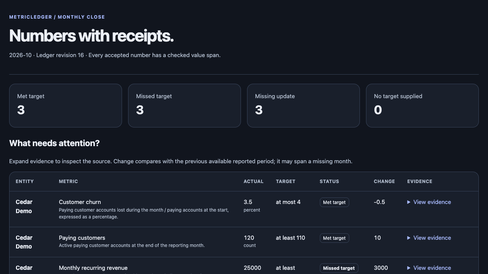

# MetricLedger

[](https://github.com/fwnivaen/metric-ledger/actions/workflows/checks.yml)
[](https://www.python.org/)
[](LICENSE)

**Turn business updates into a metric history you can trace, correct and report.**

An agent reads a client update. MetricLedger checks that the proposed number actually appears in the supplied source, keeps the original when a correction arrives, and reports missed targets and missing updates. Every accepted value has a source ID, text span and content hash.

Created and maintained by **Nivaen Giritharan**. MetricLedger is the working name for this first release.



[Download the self-contained fictional report](docs/demo-report.html), or generate it locally with the command below.

```text
Business update ── LangExtract or your agent ── Proposed JSON bundle
                                                     │
                                  Evidence + unit + conflict checks
                                         │                    │
                                    DuckDB history       Review queue
                                         │                    │
                                 Explicit target rules    Fix or dismiss
                                         │
                              HTML + JSON + CSV monthly report
```

## Try the complete demo

Requires Python 3.11 or later. All example organizations, updates, values and targets are fictional.

```bash
git clone https://github.com/fwnivaen/metric-ledger.git
cd metric-ledger
python -m venv .venv
```

Activate the environment with `source .venv/bin/activate` on macOS/Linux, or `.venv\Scripts\Activate.ps1` in Windows PowerShell. Then:

```bash
python -m pip install -e ".[extract]"
metric-ledger demo --output workspace/demo --replay-extraction
```

Open `workspace/demo/report.html` in your browser. The command also writes a JSON report, CSV export, complete fact history and review decisions.

The demo shows **three met targets, three missed targets, three missing updates and one review item**. Cedar Demo's October revenue changes from `$24,000` to `$25,000` through an explicit correction; both values remain in history. A proposed `$19,000` value backed by a `$18,000` quote is rejected into review.

No API key is needed. Replay runs the real LangExtract parsing/alignment pipeline with **recorded fixture model output**. It does not generate AI answers or measure a live model's accuracy. For a smaller installation, use `python -m pip install -e .` and omit `--replay-extraction`.

## What this project adds

| Capability | Behavior |
|---|---|
| Value evidence checks | Exact Unicode character offsets, source text and numeric-token agreement are checked before acceptance. |
| A defined metric contract | Entities, definitions, units and tracked pairs are explicit. A ledger refuses a changed catalog. |
| Correction history | A replacement names the current fact it supersedes; previous values remain queryable. |
| Revision snapshots | Recreate accepted metric values at a prior ledger revision. |
| Honest missing data | Missing updates and absent targets remain visible. There is no silent unit conversion. |
| Review workflow | Conflicts and unsupported proposals enter review. Correct an item with evidence, or dismiss it with a recorded reason. |
| Repeatable batch runs | Replaying accepted bundles, including old corrections, does not insert duplicate facts. |
| Portable output | A self-contained HTML report plus JSON/CSV; agents can use the CLI or Python API. |

## The open-source foundations

| Upstream project | Role | License |
|---|---|---|
| [LangExtract](https://github.com/google/langextract) | Optional extraction and source alignment; replaceable model providers | Apache-2.0 |
| [DuckDB](https://github.com/duckdb/duckdb) | Embedded analytical storage, revision queries and prior-period windows | MIT |
| [Pydantic](https://github.com/pydantic/pydantic) | Strict JSON contracts, exact decimal validation and generated schemas | MIT |

MetricLedger's own code connects these libraries through metric definitions, evidence checks, correction chains, review decisions, explicit target rules and the reporting workflow. See [THIRD_PARTY.md](THIRD_PARTY.md) for attribution.

## Run it with your own agent

1. Define your entities, metrics and expected reporting pairs in a catalog.
2. Have the agent produce bundles from normalized text, or configure the LangExtract adapter.
3. Review proposals, then ingest the reviewed bundles.
4. Run a monthly report against your explicitly supplied targets.

Use `metric-ledger init workspace/example` to inspect fictional input files. For real inputs, use a new database and your own catalog. Keep private inputs and generated reports under `private/` or `workspace/`, which are ignored by Git.

### One command for a batch

```bash
metric-ledger run --catalog private/catalog.json --db private/metrics.duckdb \
  --inbox private/reviewed-bundles --period 2026-10 \
  --targets private/targets.csv --output private/reports/2026-10 --fail-on-review
```

Bundle files are processed in filename order. Put an original before its correction. All input structures are checked before ingestion starts; each bundle then commits independently. A later fatal source/database conflict stops the batch, while earlier commits remain. Retrying is safe for already accepted facts. The output includes individual ingestion outcomes.

For the exported fictional workspace, use `--inbox workspace/example --pattern 'bundle-*.json'` so the catalog is not mistaken for a bundle.

### Integrate an individual update

```bash
metric-ledger schema bundle
metric-ledger status --catalog private/catalog.json --db private/metrics.duckdb
metric-ledger ingest --catalog private/catalog.json --db private/metrics.duckdb \
  --bundle private/reviewed-bundles/update.json --expected-revision 0 --fail-on-review
metric-ledger review --catalog private/catalog.json --db private/metrics.duckdb
```

Use the revision returned by `status`; `0` above applies only to an empty ledger. Commands emit JSON on stdout; operation errors go to stderr. Exit codes are `0` for success, `2` for invalid input/configuration, and `3` for review items when `--fail-on-review` is set. A batch returns `3` while any current review item remains open.

Agents with authorized command/file access can use the same contracts regardless of their model or app. See [the agent workflow](docs/AGENT_WORKFLOW.md) and [data contracts](docs/DATA_CONTRACTS.md).

### Optional model extraction

Configure a supported provider following [LangExtract's instructions](https://github.com/google/langextract#installation), then choose its model ID explicitly:

```bash
metric-ledger extract --catalog private/catalog.json --source private/update.txt \
  --source-id client-october-update --model YOUR_CONFIGURED_MODEL_ID \
  --output private/proposed-update.json
```

This writes a **proposal**, not an accepted fact. Inspect the bundle and extraction diagnostics before ingestion. Corrections must name an existing fact explicitly; the adapter does not invent correction references. Credentials belong in your provider's environment configuration, outside committed files. Hosted inference may have a cost; a local provider still needs compute. No live provider accuracy or runtime-cost claim is made by this release.

### Reproduce a prior report

```bash
metric-ledger report --catalog workspace/demo/catalog.json --db workspace/demo/ledger.duckdb \
  --period 2026-10 --targets workspace/demo/targets.csv --as-of 15
```

At revision 15, Cedar Demo's October revenue is `24000`. At revision 16 it is `25000`. A report includes the catalog hash, target-set hash, target values and evidence. Keep the target file if you need to rerun that exact comparison. The review count is explicitly the **current** review queue, even when metric values use a historical revision.

## Scope and limits

- First release: monthly periods (`YYYY-MM`) and one scalar actual per configured entity/metric/month.
- Values use decimal strings, up to 28 digits with at most eight decimal places. Supported evidence tokens include `$12,000`, `12.5k`, `€2M` and `25%`; `25%` means `25` in unit `percent`.
- A source quote proves numeric agreement. The agent/user must still review the entity, period, metric meaning, and whether a number is an actual rather than a target. The ledger does not independently establish those semantics.
- Text is UTF-8 and normalized once before extraction; spans count Unicode characters, not bytes. Source IDs cannot be reused with changed text or URI.
- DuckDB is an embedded, single-writer workflow. Serialize writers; use `--expected-revision` to guard against stale fact updates. There is no hosted multi-tenant service or inbox authentication in this release.
- Source hashes and retained history support inspection and reproducibility. They are not digital signatures or a tamper-proof security boundary against someone editing the database directly.

## Development

With [uv](https://docs.astral.sh/uv/), the lockfile reproduces the dependency set:

```bash
uv sync --locked --extra dev --extra extract
uv run pytest -q
uv run ruff check src tests
uv run ruff format --check src tests
uv run python -m build
```

The tests cover the full fictional workflow, real LangExtract alignment with fixture output, incorrect model proposals, exact decimals, unit conflicts, Unicode spans, revisions, review resolution, batch retries, output escaping and workspace preservation. GitHub checks run on Linux/Python 3.11 and 3.13 and Windows/Python 3.12, including an installed-wheel demo.

See [CONTRIBUTING.md](CONTRIBUTING.md). Original MetricLedger code is [MIT licensed](LICENSE).
